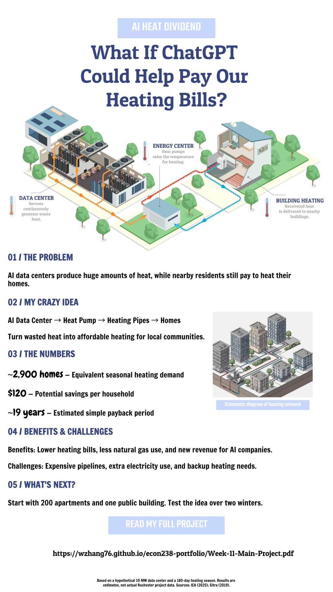

# Week 11 — AI Heat Dividend

## What If ChatGPT Could Help Pay Our Heating Bills?

*A Crazy Environmental Economics Idea for Rochester*

### My Infographic

*Click the infographic to read my full project.*

### Full Project

[**Read My Full Project (PDF)**](Week-11-Main-Project.pdf)

### About My Idea

I propose using waste heat from AI data centers to help heat nearby homes and lower residents' heating bills.

My project explores the environmental benefits, economic incentives, potential costs, and challenges of an AI Heat Dividend program in Rochester.

The calculations are based on a hypothetical scenario, not an existing Rochester project.
